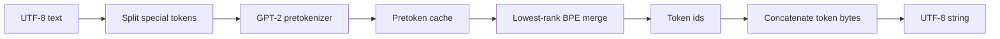
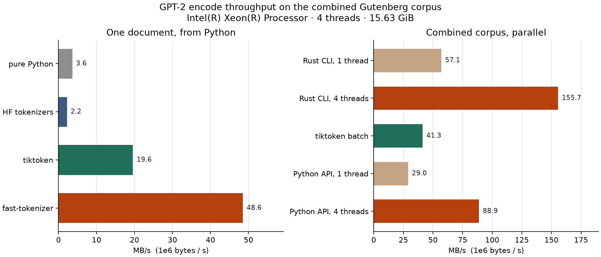

# fast-tokenizer


Byte-level BPE in Rust, with a Python extension and a pure-Python reference that follow the same rules. The tokenizer trains on a corpus, encodes text to token ids, and decodes those ids back to the original Unicode. It reads and writes the GPT-2 `vocab.json` / `merges.txt` format. On the five Project Gutenberg books in this repo, the Rust encoder and the Python reference both match tiktoken 0.14's `gpt2` encoding on all 905,180 tokens. From Python, one-document encode of that 3.28 MB corpus runs at **48.6 MB/s**, against **19.6 MB/s** for tiktoken and **3.6 MB/s** for the pure-Python reference, on a 4-thread Xeon VM. The release CLI, which does not build a Python list, reaches **57.1 MB/s** on one thread and **155.7 MB/s** with a 4-thread rayon batch.

This is a portfolio project by Kevin Fairley, aimed at agentic-AI and ML engineering roles. The interesting part is the engineering around a known algorithm: a pretokenizer that matches the GPT-2 regex, a merge loop whose priority is the line order in `merges.txt`, a trainer with a documented tie-break, and a benchmark that reports only numbers measured on this machine.

## Architecture



1. **Special tokens** such as `<|endoftext|>` are cut out of the text first. The earliest match wins, and two matches that start at the same byte resolve to the longer token.
2. **Pretokenization** uses the GPT-2 / tiktoken `r50k` pattern, implemented as a direct scanner rather than a regex engine. Contractions (`'s`, `'ll`, `'re`, …), words, numbers, and punctuation are separate pieces, and a leading ASCII space sticks to the next word. Merges never cross a piece.
3. **Byte-level vocabulary.** The alphabet is the 256 raw bytes. Bytes that would be awkward in a text file, including space and newline, are displayed as a single Unicode scalar (` ` is `Ġ`). The map is a bijection, so decoding is exact for valid Unicode.
4. **Encode** repeatedly merges the adjacent pair with the lowest rank. Rank is the line number in `merges.txt`. One pair is merged per step. A cache inside that call stores the ids of each distinct pretoken.
5. **Train** counts pairs inside pretokens, weighted by how often the pretoken occurs. The winner is the highest count; a tie goes to the lexicographically smaller pair of raw byte strings. Every non-overlapping occurrence is replaced in that same pass. Encode does not use this pass. It uses the ranks the trainer wrote down.
6. **Decode** concatenates each token's bytes and UTF-8-decodes the buffer once, so a character split across tokens comes back intact.

The Rust crate is `fast-tokenizer`. `fast-tokenizer-cli` is the `fast-tokenizer` binary. `fast-tokenizer-py` is the PyO3 module you import as `fast_tokenizer`. `python/reference_bpe.py` is the pure-Python implementation of the same rules, with no third-party dependencies. Rayon parallelizes `encode_batch` only; each string is still encoded by the single-thread function, on its own cache.

## Quickstart

Rust toolchain 1.85 or newer (this repo was tested with rustc 1.99.1) and Python 3.10+.

Encode with the bundled GPT-2 files:

```bash
cargo run --release -p fast-tokenizer-cli -- encode \
  --model data/gpt2 --text "hello world"
```

```text
[31373, 995]
```

Train a small model and round-trip it:

```bash
cargo run --release -p fast-tokenizer-cli -- train \
  --input data/sample.txt \
  --vocab-size 800 \
  --special "<|endoftext|>" \
  --output /tmp/demo-model

cargo run --release -p fast-tokenizer-cli -- encode \
  --model /tmp/demo-model --text "hello <|endoftext|> world" > /tmp/ids.json

cargo run --release -p fast-tokenizer-cli -- decode \
  --model /tmp/demo-model --file /tmp/ids.json
```

`vocab_size` counts the 256 byte tokens, the learned merges, and any special tokens. Training stops early when the corpus runs out of pairs. `--special` may be repeated. A special token that collides with a byte or a merge, such as the ordinary word `hello` after that word has been learned, is rejected.

Python extension:

```bash
python -m venv .venv && source .venv/bin/activate
pip install maturin
maturin develop --release
python -c "import fast_tokenizer; print(fast_tokenizer.Tokenizer.load('data/gpt2').encode('hello world'))"
```

```python
import fast_tokenizer

model = fast_tokenizer.Tokenizer.load("data/gpt2")
ids = model.encode("hello world")          # special tokens kept atomic
plain = model.encode_ordinary("hello world")
text = model.decode(ids)
batch = model.encode_batch(["hello", "world"], num_threads=4)

trained = fast_tokenizer.Tokenizer.train(
    open("data/sample.txt", encoding="utf-8").read(),
    vocab_size=800,
    special_tokens=["<|endoftext|>"],
)
trained.save("/tmp/demo-model")
```

The pure-Python reference lives at `python/reference_bpe.py` (`Tokenizer.train`, `Tokenizer.load`, `encode`, `decode`). It is the implementation the Rust trainer is checked against.

Run the tests:

```bash
cargo test --workspace
cargo clippy --workspace --all-targets -- -D warnings
cargo fmt --all --check
maturin develop --release
pytest -q
```

Regenerate the tiktoken fixture, then re-run the tests, with `python python/generate_fixtures.py`. The benchmark is `python python/benchmark.py`. It needs the release CLI at `target/release/fast-tokenizer` (`cargo build --release -p fast-tokenizer-cli`) plus `tiktoken`, `tokenizers`, and `matplotlib`.

## Benchmark

All figures below were measured on this VM by `python python/benchmark.py`. The clock is `time.perf_counter`. Each cell is the median of 5 runs after 1 warmup. MB/s divides UTF-8 bytes by that time and by 1,000,000. Model load time is excluded. The release profile is thin LTO and `codegen-units = 1`.

Hardware: Intel Xeon (KVM), 4 threads, 15.6 GiB RAM, Linux 6.12, rustc 1.99.1, Python 3.12.3, tiktoken 0.14.0, Hugging Face `tokenizers` 0.23.3.

Corpus: Alice (`pg11`), Frankenstein (`pg84`), Pride and Prejudice (`pg1342`), Sherlock Holmes (`pg1661`), and Moby Dick (`pg2701`). Combined size 3,279,503 bytes. Sources and sha256 hashes are in [`data/SOURCES.md`](data/SOURCES.md).



### One document, called from Python

Includes building the Python list of token ids. Token parity with tiktoken is exact (905,180 tokens).

| implementation | median s | MB/s | tokens/s |
| --- | ---: | ---: | ---: |
| pure Python reference | 0.902 | 3.64 | 1,003,718 |
| HF tokenizers `encode` | 1.466 | 2.24 | 617,264 |
| tiktoken | 0.167 | 19.61 | 5,411,275 |
| fast-tokenizer | 0.068 | 48.56 | 13,402,683 |

| corpus | fast-tokenizer | tiktoken | HF tokenizers | pure Python | tokens |
| --- | ---: | ---: | ---: | ---: | ---: |
| Alice | 38.83 | 17.64 | 3.47 | 3.11 | 52,948 |
| Pride and Prejudice | 46.80 | 19.96 | 2.91 | 3.15 | 211,562 |
| Sherlock Holmes | 47.27 | 19.59 | 3.16 | 3.42 | 172,125 |
| Moby Dick | 42.96 | 17.69 | 2.64 | 3.30 | 354,334 |
| Frankenstein | 43.71 | 20.72 | 3.52 | 3.31 | 114,211 |
| combined | 48.56 | 19.61 | 2.24 | 3.64 | 905,180 |

HF's single-string `encode` also builds offset maps, and on a multi-megabyte string that cost dominates. Its `encode_batch` on ~64 KiB chunks is 9.77 MB/s, which is the fairer reading of that library.

### Parallel encode

The combined corpus is split on blank lines into ~64 KiB chunks (49 from Python, 50 from the CLI; the files are CRLF). On this corpus the chunked ids are identical to the one-document ids. The CLI numbers do not build a Python list. The Python rows do.

| implementation | MB/s | tokens/s |
| --- | ---: | ---: |
| Rust CLI, 1 thread | 57.10 | 15,761,137 |
| Rust CLI, 4 threads (rayon, 50 chunks) | 155.70 | 42,974,809 |
| Python `encode_batch`, 1 thread | 29.01 | 8,006,950 |
| Python `encode_batch`, 4 threads | 88.91 | 24,541,111 |
| tiktoken `encode_ordinary_batch` | 41.26 | 11,387,926 |
| HF `encode_batch` | 9.77 | 2,696,681 |
| pure Python, chunk loop | 2.41 | 664,039 |

Four threads are 2.7× the CLI's one-thread time (57.1 → 155.7 MB/s) and 3.1× the Python batch's own one-thread time (29.0 → 88.9 MB/s). The gap between the CLI's 155.7 MB/s and the Python batch's 88.9 MB/s is the cost of materializing about 905,000 Python integers after the Rust work returns.

Full tables, per-run min/max, and the hardware record are in [`benchmarks/results.md`](benchmarks/results.md) and [`benchmarks/raw.json`](benchmarks/raw.json).

## How it was built

I designed and directed this project and built it with AI coding agents: I set the requirements (exact token parity with tiktoken and Hugging Face on real text, a pure-Python reference to benchmark against, and published hardware details with every number), reviewed the results, and drove the fixes.

## What I learned

**A merges file that starts with `#` is not a comment syntax.** GPT-2's `merges.txt` has a `#version: 0.2` header and, later, real merges whose left token is `#` (`# #`, `## ##`, …). Treating every `#` line as a comment drops eight merges. `##` then looks like an extra special token, and any text with a markdown heading silently diverges from tiktoken. The loader skips a leading `#version` line and parses everything else.

**Encode and train are different loops, on purpose.** Training replaces every non-overlapping occurrence of the winning pair in one pass. Encode ignores frequency and merges whichever adjacent pair currently has the lowest rank, one pair at a time. Those two procedures agree on ordinary words and disagree on some overlapping strings. The educational tiktoken loop, and the GPT-2 parity tests, follow the one-pair encode rule. The reference trainer and the Rust trainer share the frequency rule, including the tie-break.

**The tie-break has to use raw bytes.** Space is byte `0x20` and displays as `Ġ` (U+0120). Sorting pairs by the display string puts `a` before space; sorting by the bytes does the opposite. Both implementations compare the underlying bytes, so a HashMap's iteration order cannot change the vocabulary.

**The pretokenizer is where parity is won or lost.** `"hello\n\n"` is one newline piece because the run is at the end of the string. `"hello\n\nworld"` is two newline pieces, because the regex gives the last whitespace back to the next word. A scanner that always keeps a whitespace run together, or always splits it, fails round-trip parity even when the merge table is perfect. The same rule showed up again in the benchmark: these Gutenberg files use CRLF, so a splitter that searches for `\n\n` never finds a boundary and rayon is handed a single chunk. The published parallel numbers use a blank-line split that understands `\r\n\r\n`.

**The cache is the whole speed story on prose.** A novel repeats a few tens of thousands of pretokens. Both encoders memoize the ids for the duration of one call, which is what the original GPT-2 encoder does. Against that same algorithm, Rust is about 13× the pure-Python reference (48.6 vs 3.6 MB/s from Python), which is a believable language gap. An uncached Python loop would have made the chart look more dramatic and would have measured memoization.

**Crossing into Python hides thread scaling until you measure both sides.** `encode_batch` releases the GIL and uses rayon. On four cores the CLI goes from 57.1 to 155.7 MB/s. The same batch, observed from Python, goes from 29.0 to 88.9 MB/s, because the timer includes building the list of ints. Reporting only the Python number would have made rayon look weaker than it is. Reporting only the CLI number would have hidden what a Python caller actually waits for.

**Parity is exact on the corpus I checked, and that is the claim.** tiktoken 0.14 `gpt2`, the Rust encoder, the pure-Python reference, and Hugging Face `tokenizers` all produced the same 905,180 ids for the combined books, and the same ids on a fixture of contractions, CJK, emoji, combining marks, and `<|endoftext|>`. The fixture is regenerated from tiktoken by `python/generate_fixtures.py`, and CI checks the implementations against that file.

## Roadmap

- A neighbor-update merge loop for the occasional long pretoken, in place of rescanning the whole piece.
- Aho-Corasick (or an equivalent) once a model has more than a handful of special tokens.
- Streaming encode for files that should not be resident all at once.
- Export to a Hugging Face `tokenizer.json`.
- Ship the `.pyi` stub inside the wheel.
- Memory-map the training corpus so a multi-gigabyte run does not need a single `String`.

## Layout

```text
crates/fast-tokenizer/        library: train, encode, decode, GPT-2 files
crates/fast-tokenizer-cli/    fast-tokenizer encode|decode|train|bench
crates/fast-tokenizer-py/     PyO3 module, imported as fast_tokenizer
python/reference_bpe.py       pure-Python reference
python/benchmark.py           throughput harness and chart
python/tests/                 reference, bindings, tiktoken fixture
data/gpt2/                    GPT-2 vocab.json and merges.txt
data/corpora/                 Project Gutenberg texts
benchmarks/                   measured results and throughput.png
```

## License

MIT. See [LICENSE](LICENSE). The GPT-2 vocabulary and merge file are the files tiktoken pins for the `gpt2` encoding; their hashes and the Gutenberg sources are listed in [`data/SOURCES.md`](data/SOURCES.md).
